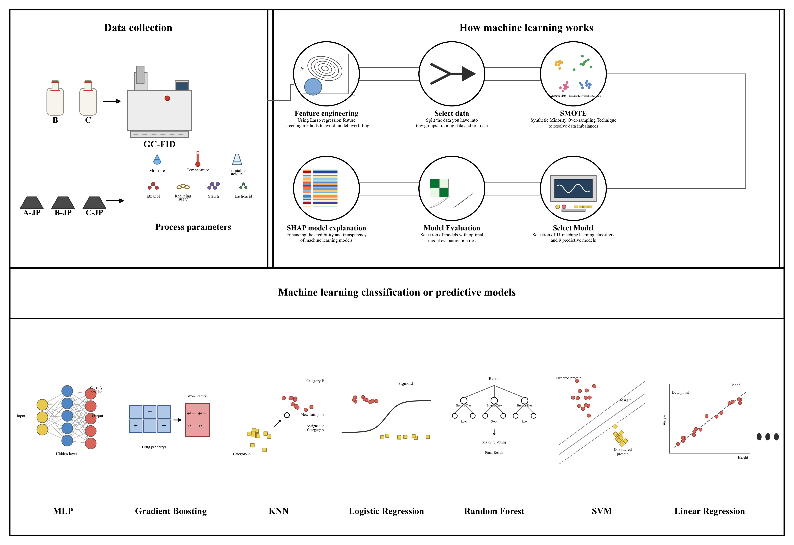
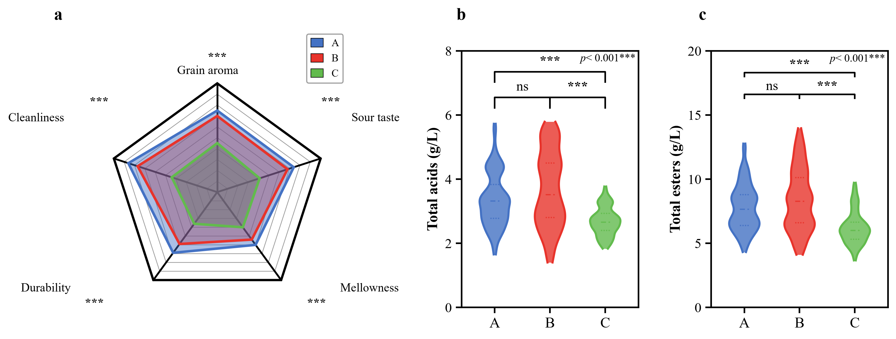
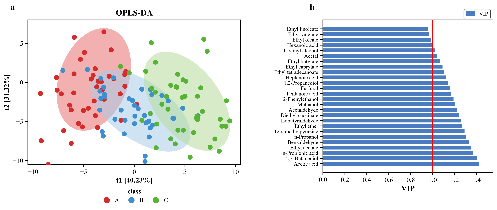
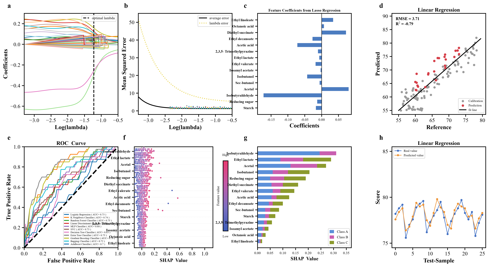
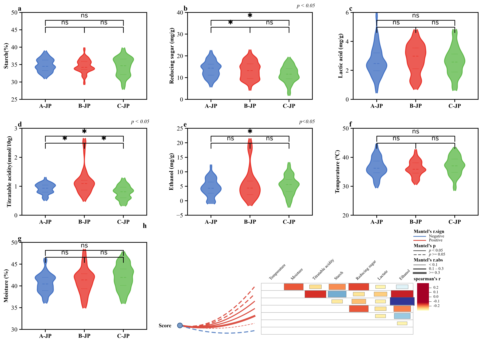
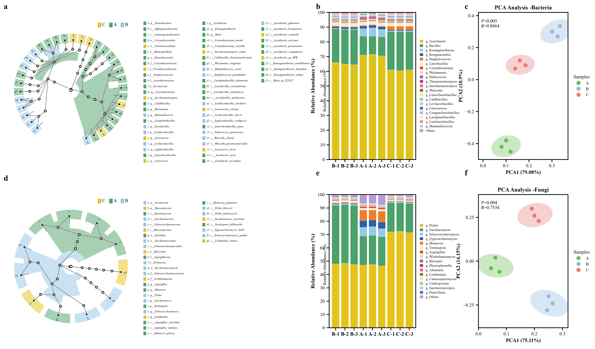

# 科研图表复现 · Scientific Figure Reproduction

用 **matplotlib 从零重绘学术论文插图**的可复现代码库。本仓库以一个真实案例——*Food Chemistry: X* 上关于酱香型白酒质量等级机器学习判别的论文——为例，把文中全部 6 张复合图（共 30 余个子图）用纯 Python 逐图重建，并保留可直接改数据、改样式的模板代码。

**用途**：论文插图模板 / 图表复现练习 / matplotlib 进阶示例（雷达图、小提琴图+显著性标注、OPLS-DA 置信椭圆、VIP 条形图、Lasso 系数路径、SHAP 蜂群图、ROC 曲线、Mantel 检验面板、LEfSe 进化分支图、堆叠柱状图、配方示意图）。

---

## 图表示例

| 图 | 主题 | 用到的绘图技术 |
|---|---|---|
|  | **Fig. 1** 机器学习建模流程图 | 纯矢量示意图：圆内嵌图标、流程连线、算法缩略图（7 个 inset 子坐标系） |
|  | **Fig. 2** 感官雷达图 + 总酸/总酯小提琴图 | 五边形雷达图、KDE 小提琴、显著性括号（ns / \*\*\*） |
|  | **Fig. 3** OPLS-DA 得分图 + VIP 条形图 | 旋转置信椭圆、散点分组、横向条形图 + VIP=1 阈值线 |
|  | **Fig. 4** Lasso 特征筛选 + 分类/回归评价 8 面板 | 系数路径、CV 误差曲线、系数条形图、拟合散点、ROC、SHAP 蜂群/堆叠条形 |
|  | **Fig. 5** 酒醅理化指标 + Mantel 检验 | 7 个小提琴面板、相关方块矩阵、扇形连线图、多组图例与色标 |
|  | **Fig. 6** LEfSe 进化分支图 + 群落结构 + PCA | 极坐标树形分类图（自写递归布局）、堆叠柱 + 属级图例、PCA 置信椭圆 |

> 图片为 300 dpi PNG，位于 `outputs/`；脚本在 `figures/`。

---

## 目录结构

```
sci-figure-repro/
├── common.py                     # 全局样式 + 复用组件（小提琴、显著性括号、保存）
├── run_all.py                    # 一键重绘全部图
├── requirements.txt
├── figures/
│   ├── fig1_workflow.py          # 流程图
│   ├── fig2_radar_violin.py      # 雷达图 + 小提琴图
│   ├── fig3_oplsda_vip.py        # OPLS-DA + VIP
│   ├── fig4_lasso_models.py      # Lasso / ROC / SHAP / 回归
│   ├── fig5_physchem_mantel.py   # 理化指标 + Mantel
│   └── fig6_lefse_pca.py         # LEfSe + 群落结构 + PCA
├── outputs/                      # 生成的 PNG
└── docs/
    └── notes.md                  # 每张图的设计要点与改造指引
```

## 环境

```bash
python -m pip install -r requirements.txt
```

依赖：`numpy`、`matplotlib`、`scipy`、`pandas`、`scikit-learn`（仅 Fig.4 的 ROC 示例用）、`shap` 非必需（SHAP 图由手写蜂群布局实现）。

字体默认 `Times New Roman`（找不到时自动回退 `DejaVu Serif`）。中文期刊若需宋体/思源宋体，改 `common.py` 里的 `font.serif` 即可。

## 运行

```bash
python figures/fig1_workflow.py          # 单张
python run_all.py                        # 全部
```

输出写到 `outputs/`，可在任意目录下运行（脚本内部按文件位置定位路径）。

---

## 关于数据

原文未公开原始数据。本仓库中的数据是按论文**报告的统计量**（各组均值、标准差、AUC、R²、菌群相对丰度、VIP 值、化合物名称与排序等）用固定随机种子生成的合成数据，因此：

- 趋势、组间差异、坐标轴范围、图例与文字标注与原文一致；
- 散点 / 小提琴的**逐点位置**不可能与原文完全相同。

把 `figures/*.py` 顶部的数据块（如 `panels`、`vip`、`comp`、`pts`）替换为自己的数据即可直接出图——这也是本仓库作为"图表模板"的主要用法。

## 原著论文

> Li, S., Li, T., Han, Y., Yan, P., Li, G., Ren, T., Yan, M., Lu, J., & Qiu, S. (2024).
> *Machine learning discrimination and prediction of different quality grades of sauce-flavor baijiu based on biomarker and key flavor compounds screening.*
> **Food Chemistry: X**, 24, 101877. https://doi.org/10.1016/j.fochx.2024.101877
> （CC BY-NC 4.0 开放获取）

本仓库仅包含**重绘代码与重绘结果**，不包含原文 PDF 或原文图片；图中的化合物名称、微生物分类名、数值标注等属于科学事实，图表设计向原文致敬，版权归原作者所有。若用于论文，请引用上述原文。

## License

代码采用 MIT License，可自由用于学术图表。由本仓库代码生成的图像请在致谢中注明来源论文出处。
